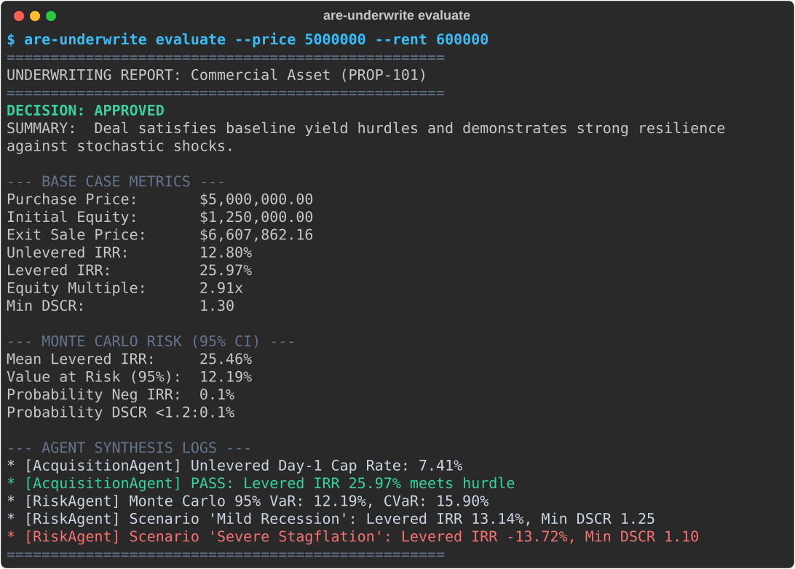
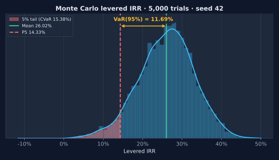
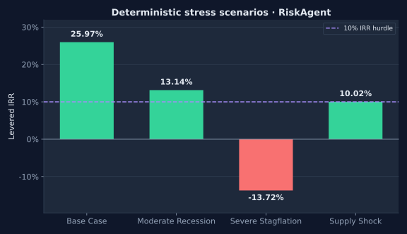
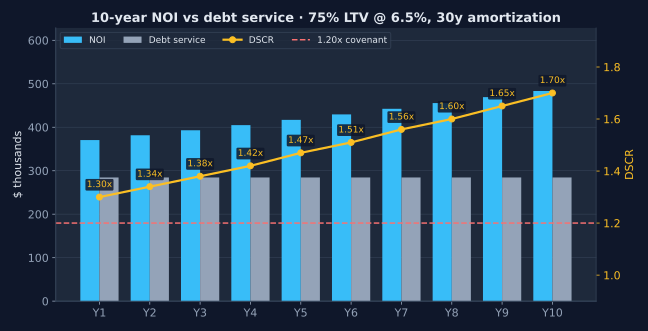
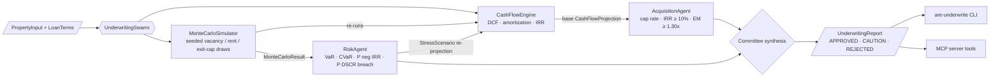

# Autonomous Real Estate Underwriting Swarm


Multi-agent commercial real estate underwriting: deterministic DCF and debt-service modelling, seeded Monte Carlo
risk simulation, and macro stress tests. You can run it from the CLI or expose it to an LLM as Model Context Protocol tools.



> Every image in this README is generated by [`scripts/make_docs_assets.py`](scripts/make_docs_assets.py). The script runs the
> real package with seed `42`, so re-running it produces byte-identical SVGs.

## Quickstart

```bash
pip install -e ".[dev]"
are-underwrite evaluate --price 5000000 --rent 600000
are-underwrite simulate --price 5000000 --rent 600000 --iterations 5000
are-underwrite mcp                       # stdio MCP server
pytest                                   # 23 tests
```

Regenerate the docs assets:

```bash
pip install -e ".[docs]"
python scripts/make_docs_assets.py
```

## Risk at a glance

<table>
  <tr>
    <td width="50%"></td>
    <td width="50%"></td>
  </tr>
  <tr>
    <td><sub>5,000 trials that shock vacancy, rent growth and exit cap. The chart marks the mean, P5 and 95% VaR (mean − P5).</sub></td>
    <td><sub>Base case compared with three deterministic macro shocks, measured against the 10% levered-IRR hurdle.</sub></td>
  </tr>
</table>



## Architecture



The decision rule: if both agents pass, the deal is **APPROVED**. If acquisition passes and risk fails, the deal is **CAUTION**. Any other outcome is **REJECTED**.

## Underwriting metrics

| Metric | Definition | Gate |
|---|---|---|
| Day-1 cap rate | GPR × (1 − vacancy) × (1 − opex ratio) / price | reported |
| Levered IRR | IRR of −equity, cash flow after debt, plus net sale proceeds | ≥ 10% (AcquisitionAgent) |
| Equity multiple | Σ distributions / initial equity | ≥ 1.30x (AcquisitionAgent) |
| DSCR | NOI / annual debt service | 1.20x covenant |
| VaR (95%) | mean IRR − 5th-percentile IRR | reported |
| CVaR (95%) | mean IRR − mean of the ≤ P5 tail | reported |
| P(negative IRR) | share of trials with IRR < 0 | ≤ 10% (RiskAgent) |
| P(DSCR breach) | share of trials with min DSCR < 1.20 | ≤ 20% (RiskAgent) |

## CLI commands

| Command | Required | Options |
|---|---|---|
| `are-underwrite evaluate` | `--price`, `--rent` | `--id`, `--name`, `--vacancy 0.05`, `--opex 0.35`, `--ltv 0.75`, `--rate 0.065`, `--json` |
| `are-underwrite simulate` | `--price`, `--rent` | `--iterations 1000`, `--json` |
| `are-underwrite mcp` | none | Starts the MCP server over stdio |

## MCP tools

| Tool | Purpose | Key parameters |
|---|---|---|
| `project_cash_flows` | Pro-forma cash flows, DSCR, levered/unlevered IRR | `purchase_price`, `gross_potential_rent`, `holding_period_years`, `exit_cap_rate`, `ltv`, `interest_rate` |
| `run_monte_carlo` | Stochastic IRR distribution and tail risk | `iterations=500`, `vacancy_std`, `rent_growth_std`, `exit_cap_std` |
| `evaluate_deal` | Full swarm report with committee decision | `property_id`, `name`, `purchase_price`, `gross_potential_rent` |

Example MCP client config:

```json
{ "mcpServers": { "real-estate": { "command": "are-underwrite", "args": ["mcp"] } } }
```

<details>
<summary><b>Methodology</b></summary>

**Cash flows.** In year 1, GPR plus other income, minus vacancy, gives EGI. Opex is a fixed ratio of EGI. NOI less debt service
gives the levered cash flow. From year 2 onward, GPR grows at `annual_rent_growth`.

**Debt.** The loan is a fully amortizing mortgage with monthly payments, by default 30 years at 6.5% and 75% LTV. The exit balance comes from the closed-form
remaining-principal formula.

**Exit.** Sale price = forward NOI (final-year NOI × (1 + growth)) / exit cap. Net proceeds = sale price minus the loan balance, floored at 0.

**IRR.** Newton–Raphson starts at 10%. If it fails, the solver falls back to bisection on [−90%, 500%].

**Monte Carlo.** Each trial draws from independent normals, using `numpy.random.default_rng(seed)`:
vacancy ~ N(v, 2%) clipped to [0, 95%], rent growth ~ N(g, 1.5%), and exit cap ~ N(c, 0.75%) clipped to [2%, 25%].
Every trial runs the full deterministic projection again. The default seed is `42`, so results are reproducible.

**Stress tests.** Each scenario adds a vacancy bump, subtracts a rent-growth decline, and widens the exit cap by a number of basis points.
The swarm's default scenarios are *Mild Recession* (+4% vac, −2% growth, +50 bps) and *Severe Stagflation*
(+8%, −5%, +125 bps). The chart above also includes *Supply Shock* (+6%, −3%, +25 bps), which is passed in through
`run_underwriting(prop, stress_scenarios=...)`.

</details>

## License

MIT
